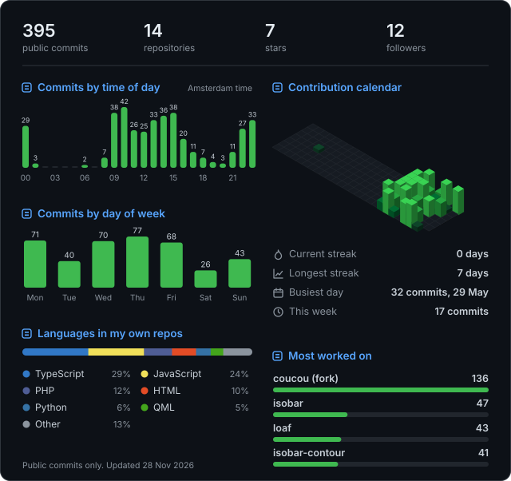

Software engineering student in Middelburg. I build small things I wish existed.

- [isobar](https://github.com/CaptainPancakeWithBacon/isobar): a GNOME extension that takes its colours from your wallpaper.
- [loaf](https://github.com/CaptainPancakeWithBacon/loaf): a quiet, low-power shell for niri on my laptop.
- [coucou](https://github.com/CaptainPancakeWithBacon/coucou): my fork, with a Windows build so my friends can use it too.
- [Mini-Waterways](https://github.com/CaptainPancakeWithBacon/Mini-Waterways): Mini Motorways and Mini Metro, but with ships.
