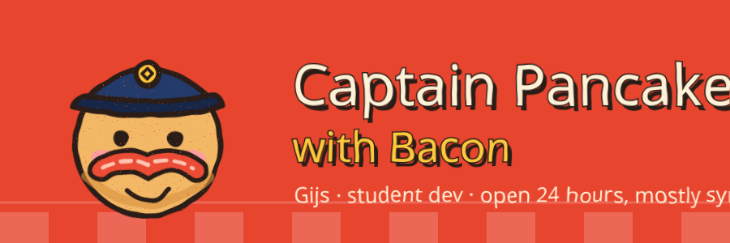
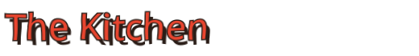
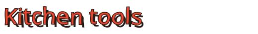
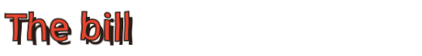

<p align="center"></p>


*pinned repos, cooked fresh*

- **[isobar](https://github.com/CaptainPancakeWithBacon/isobar)** `GNOME` An adaptive GNOME interface that takes its colours from your wallpaper.
- **[coucou](https://github.com/CaptainPancakeWithBacon/coucou)** `fork` My fork of a tiny friend that keeps an eye on your AI coding agents.
- **[niri-mist](https://github.com/CaptainPancakeWithBacon/niri-mist)** `QML` A niri + Quickshell session. Parked, still tasty.
- **[Mini-Waterways](https://github.com/CaptainPancakeWithBacon/Mini-Waterways)** `TypeScript` Mini Motorways and Mini Metro, but with ships.



*live, redone every night from my public GitHub activity*




- a naive design rebrand (you're looking at it)
- getting isobar onto extensions.gnome.org



Laravel · Symfony · Svelte · Tailwind · Docker · GJS



```
1x curiosity ............ free
2x side projects ........ too many
1x D&D campaign ......... sneaky
TOTAL ................... thanks for stopping by
```
