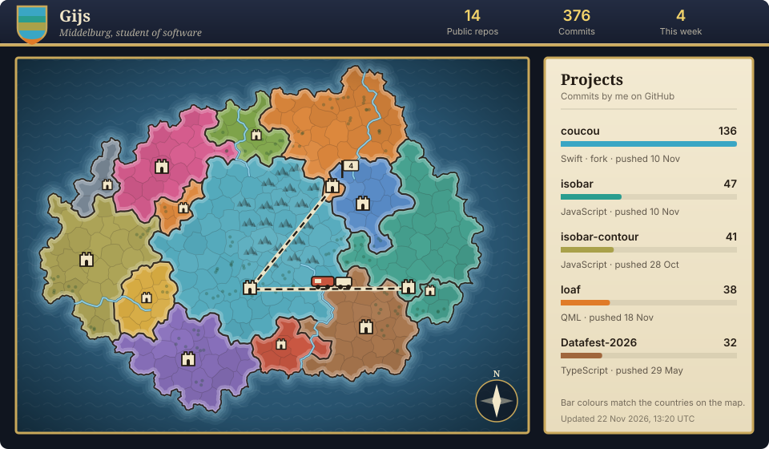

Hey, I'm Gijs. Software engineering student in Middelburg, mostly building small things I wish existed. Linux desktops, little games, and a D&D habit that keeps spawning side projects.

The map above redraws itself every few hours from my GitHub activity. Each public repo is a country, bigger the more I commit to it. The flags are this week's commits.

- [isobar](https://github.com/CaptainPancakeWithBacon/isobar): a GNOME extension that takes its colours from your wallpaper.
- [loaf](https://github.com/CaptainPancakeWithBacon/loaf): a quiet, low-power shell for niri on my laptop.
- [coucou](https://github.com/CaptainPancakeWithBacon/coucou): my fork of coucou, with a Windows build so my friends can use it too.
- [Mini-Waterways](https://github.com/CaptainPancakeWithBacon/Mini-Waterways): Mini Motorways and Mini Metro, but with ships.

Laravel, Livewire, Tailwind, Symfony, Svelte, TypeScript, Docker, GJS
